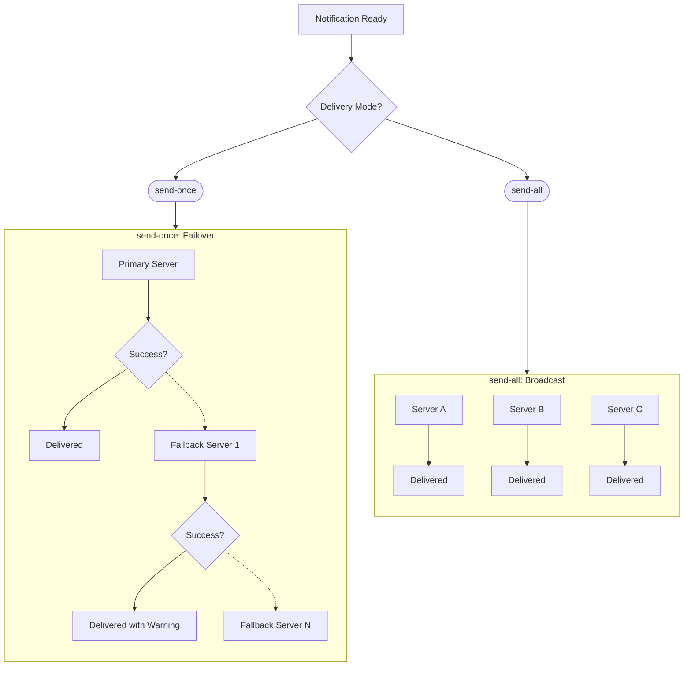

import { Terminology } from '@cbnventures/docusaurus-preset-nova/blocks';

Choose between `send-once` failover and `send-all` broadcast to control how notifications reach your ntfy <Terminology title="One of your ntfy instances: a name, URL, and token" to="/docs/reference/terminology#ntfy-servers-and-messages">servers</Terminology>.

Both modes use [durable delivery](/docs/features/durable-delivery/) for normal notifications: the proxy saves the formatted notification before sending and keeps transiently failed work in a FIFO lane dedicated to that context. Durable Object alarms retry network errors, HTTP 408, HTTP 429, and HTTP 5xx responses with backoff. Error-topic diagnostics use the same server mode but are one-shot, best-effort sends outside the lane, so a failed diagnostic cannot block later alerts.



## send-once

Tries the <Terminology title="The ntfy server send-once tries first" to="/docs/reference/terminology#ntfy-servers-and-messages">primary server</Terminology> first. If it fails (network error, non-2xx response), the next <Terminology title="One of your ntfy instances: a name, URL, and token" to="/docs/reference/terminology#ntfy-servers-and-messages">server</Terminology> in the list is tried.

This continues until one <Terminology title="One of your ntfy instances: a name, URL, and token" to="/docs/reference/terminology#ntfy-servers-and-messages">server</Terminology> succeeds or all have been exhausted. When a fallback <Terminology title="One of your ntfy instances: a name, URL, and token" to="/docs/reference/terminology#ntfy-servers-and-messages">server</Terminology> delivers the notification, a warning is prepended to the message body.

The prepended warning uses this format:

```text
⚠️ Primary server "primary" was unreachable. This notification was delivered via "secondary".
```

The <Terminology title="One of your ntfy instances: a name, URL, and token" to="/docs/reference/terminology#ntfy-servers-and-messages">server</Terminology> names in the warning match the names from your config, not fixed labels.

Best for:

- **Redundancy setups** — You want notifications delivered reliably, but only once.
- **Multiple ntfy instances** — A primary NAS <Terminology title="One of your ntfy instances: a name, URL, and token" to="/docs/reference/terminology#ntfy-servers-and-messages">server</Terminology> with a cloud backup.

## send-all

Sends the notification to every <Terminology title="One of your ntfy instances: a name, URL, and token" to="/docs/reference/terminology#ntfy-servers-and-messages">server</Terminology> in the <Terminology title="One alert source: its address, interpreter, and topic" to="/docs/reference/terminology#how-it-works">context</Terminology>'s `servers` list simultaneously. All <Terminology title="One of your ntfy instances: a name, URL, and token" to="/docs/reference/terminology#ntfy-servers-and-messages">servers</Terminology> receive the same notification in parallel.

The durable notification remains saved until every configured server succeeds, a permanent failure makes it undeliverable, or a transient failure persists past the 24-hour age limit with at least three attempts. Successful servers and message stages are checkpointed, so a retry contacts only unfinished work. A failed transient destination therefore does not cause successful stages to be sent again.

Best for:

- **Synchronized instances** — You want the same notification on multiple devices or <Terminology title="One of your ntfy instances: a name, URL, and token" to="/docs/reference/terminology#ntfy-servers-and-messages">servers</Terminology>.
- **Multi-site deployments** — Each site runs its own ntfy <Terminology title="One of your ntfy instances: a name, URL, and token" to="/docs/reference/terminology#ntfy-servers-and-messages">server</Terminology> and should receive all notifications.

## Server Failover

In `send-once` mode, failover is automatic and ordered:

1. The `primary_server` is tried first.
2. If it fails, the remaining <Terminology title="One of your ntfy instances: a name, URL, and token" to="/docs/reference/terminology#ntfy-servers-and-messages">servers</Terminology> from the `servers` list (excluding the primary) are tried in order.
3. This continues until one succeeds or all fail.

The response carries a `fallback_note` when a fallback delivered the notification. With `show_response_output` enabled, it also lists which <Terminology title="One of your ntfy instances: a name, URL, and token" to="/docs/reference/terminology#ntfy-servers-and-messages">servers</Terminology> succeeded or failed. In `send-all` mode, there is no failover — every <Terminology title="One of your ntfy instances: a name, URL, and token" to="/docs/reference/terminology#ntfy-servers-and-messages">server</Terminology> is contacted regardless of individual failures.

## IP Forwarding

The proxy sets the `X-Forwarded-For` header on outgoing requests to ntfy <Terminology title="One of your ntfy instances: a name, URL, and token" to="/docs/reference/terminology#ntfy-servers-and-messages">servers</Terminology> using the original client IP from Cloudflare's `cf-connecting-ip` header. This means your ntfy <Terminology title="One of your ntfy instances: a name, URL, and token" to="/docs/reference/terminology#ntfy-servers-and-messages">server</Terminology> sees the real client IP, not the Cloudflare edge IP.

This applies to all delivery modes.

## ntfy Headers

The proxy sets these <Terminology title="The X-Title, X-Priority, and friends sent to ntfy" to="/docs/reference/terminology#ntfy-servers-and-messages">ntfy headers</Terminology> on outgoing requests based on the <Terminology title="Turns one app's raw alert into a clean ntfy message" to="/docs/reference/terminology#how-it-works">interpreter</Terminology>'s notification output. <Terminology title="Turns one app's raw alert into a clean ntfy message" to="/docs/reference/terminology#how-it-works">Interpreters</Terminology> transform the incoming payload and return a <Terminology title="The title, body, and tags an interpreter hands back" to="/docs/reference/terminology#how-it-works">notification object</Terminology>, and the format stage maps those fields to headers.

| Header       | Notification Field | Description                                                                                                                                                                                          |
|--------------|--------------------|------------------------------------------------------------------------------------------------------------------------------------------------------------------------------------------------------|
| `X-Title`    | `title`            | Message title displayed prominently in the notification.                                                                                                                                             |
| `X-Priority` | `priority`         | Priority level from 1 (min) to 5 (max). Controls alert urgency and phone vibration.                                                                                                                  |
| `X-Tags`     | `tags`             | Comma-separated tags. Emoji shortcodes (e.g., `warning`) render as icons.                                                                                                                            |
| `X-Markdown` | `markdown`         | Set to `true` to enable Markdown rendering in the message body.                                                                                                                                      |
| `X-Icon`     | `icon`             | URL of a custom notification icon.                                                                                                                                                                   |
| `X-Actions`  | `actions`          | Action buttons (view URL, broadcast, HTTP request).                                                                                                                                                  |
| `X-Attach`   | `attach`           | URL of a file to download and attach to the notification.                                                                                                                                            |
| `X-Filename` | `filename`         | Filename for an <Terminology title="A file sent along with the notification" to="/docs/reference/terminology#ntfy-servers-and-messages">attachment</Terminology> sent as binary in the request body. |

:::info
The `ntfy-json` <Terminology title="Turns one app's raw alert into a clean ntfy message" to="/docs/reference/terminology#how-it-works">interpreter</Terminology> supports all of these fields directly from the JSON payload. Other <Terminology title="Turns one app's raw alert into a clean ntfy message" to="/docs/reference/terminology#how-it-works">interpreters</Terminology> (like `synology`, `seerr`, `statuspage`) set a subset automatically based on the parsed content.
:::

:::warning
The proxy builds outgoing headers from the <Terminology title="Turns one app's raw alert into a clean ntfy message" to="/docs/reference/terminology#how-it-works">interpreter</Terminology>'s <Terminology title="The title, body, and tags an interpreter hands back" to="/docs/reference/terminology#how-it-works">notification object</Terminology>. Incoming request headers — including ntfy-specific ones like `X-Click`, `X-Delay`, `X-Email`, `X-Call`, and `X-Template` — are **not forwarded** to ntfy <Terminology title="One of your ntfy instances: a name, URL, and token" to="/docs/reference/terminology#ntfy-servers-and-messages">servers</Terminology>. Only the 8 headers listed above come from the notification; delivery itself adds `Authorization`, plus `X-Forwarded-For` and `X-Sequence-ID` when they apply. For the full list of ntfy-supported headers, see the [ntfy publishing docs](https://docs.ntfy.sh/publish/).
:::

If no <Terminology title="Turns one app's raw alert into a clean ntfy message" to="/docs/reference/terminology#how-it-works">interpreter</Terminology> sets a title, the proxy falls back to the <Terminology title="One alert source: its address, interpreter, and topic" to="/docs/reference/terminology#how-it-works">context</Terminology>'s `name` field. For full documentation on <Terminology title="The X-Title, X-Priority, and friends sent to ntfy" to="/docs/reference/terminology#ntfy-servers-and-messages">ntfy headers</Terminology>, see the [ntfy publishing docs](https://docs.ntfy.sh/publish/).

## Attachments

When a notification carries a binary <Terminology title="A file sent along with the notification" to="/docs/reference/terminology#ntfy-servers-and-messages">attachment</Terminology>, delivery happens in two stages per <Terminology title="One of your ntfy instances: a name, URL, and token" to="/docs/reference/terminology#ntfy-servers-and-messages">server</Terminology>:

1. **Stage 1** — POST each text message part with <Terminology title="The X-Title, X-Priority, and friends sent to ntfy" to="/docs/reference/terminology#ntfy-servers-and-messages">ntfy headers</Terminology>.
2. **Stage 2** — PUT the binary <Terminology title="A file sent along with the notification" to="/docs/reference/terminology#ntfy-servers-and-messages">attachment</Terminology> with the `X-Filename` header.

The `plain-text` <Terminology title="Turns one app's raw alert into a clean ntfy message" to="/docs/reference/terminology#how-it-works">interpreter</Terminology> preserves a binary request body, such as an image, as the <Terminology title="A file sent along with the notification" to="/docs/reference/terminology#ntfy-servers-and-messages">attachment</Terminology>. Because it has no text part, each <Terminology title="One of your ntfy instances: a name, URL, and token" to="/docs/reference/terminology#ntfy-servers-and-messages">server</Terminology> gets only the PUT. Error topics likewise send `error-debug.json` as an attachment-only PUT, but those diagnostics are best-effort rather than durable.

### Attachment Message Count

The number of messages you receive depends on the delivery mode. For example, an <Terminology title="Where you hear about alerts the proxy couldn't handle" to="/docs/reference/terminology#ntfy-servers-and-messages">error topic</Terminology> notification with `mode` set to `send-all` and two ntfy <Terminology title="One of your ntfy instances: a name, URL, and token" to="/docs/reference/terminology#ntfy-servers-and-messages">servers</Terminology> configured arrives as two messages, one `error-debug.json` <Terminology title="A file sent along with the notification" to="/docs/reference/terminology#ntfy-servers-and-messages">attachment</Terminology> per <Terminology title="One of your ntfy instances: a name, URL, and token" to="/docs/reference/terminology#ntfy-servers-and-messages">server</Terminology>.

Visitor details from `show_visitor_info` are appended to the text body rather than sent as a separate message, so they never add to the count.

:::info
Customizations made via headers are not applied to the <Terminology title="A file sent along with the notification" to="/docs/reference/terminology#ntfy-servers-and-messages">attachment</Terminology> message. This prevents duplicate high-priority vibrations (from `X-Priority: 5`) on the <Terminology title="A file sent along with the notification" to="/docs/reference/terminology#ntfy-servers-and-messages">attachment</Terminology> message.
:::

## Smart Message Splitting

Messages exceeding 4000 UTF-8 bytes are automatically split into numbered parts. Each part gets a title suffix indicating its position (e.g., "(1/3)", "(2/3)", "(3/3)").

Splitting respects UTF-8 character boundaries so multi-byte characters are never broken mid-sequence. The split threshold aligns with ntfy's recommended message size limits.

## Response Format

The <Terminology title="The proxy itself, running on your Cloudflare account" to="/docs/reference/terminology#how-it-works">worker</Terminology> returns a JSON response after delivery. The default response includes only the status:

```json
{
  "status": "success"
}
```

If a fallback <Terminology title="One of your ntfy instances: a name, URL, and token" to="/docs/reference/terminology#ntfy-servers-and-messages">server</Terminology> was used, the status is `partial`, because the <Terminology title="The ntfy server send-once tries first" to="/docs/reference/terminology#ntfy-servers-and-messages">primary server</Terminology> failed, and a `fallback_note` field is included:

```json
{
  "status": "partial",
  "fallback_note": "Delivered via fallback server \"secondary\""
}
```

When `show_response_output` is enabled, the response includes full details:

```json
{
  "status": "success",
  "context": "GitHub Status",
  "interpreter": "statuspage",
  "servers": [
    { "name": "primary", "status": 200, "success": true, "stages": ["stage-1: ok"] }
  ],
  "message": {
    "title": "[githubstatus.com] Elevated Error Rates",
    "body_size": 342,
    "parts": 1,
    "has_attachment": false
  }
}
```

Possible status values:

- `"success"` — Every <Terminology title="One of your ntfy instances: a name, URL, and token" to="/docs/reference/terminology#ntfy-servers-and-messages">server</Terminology> that was tried returned 2xx: every server in `send-all`, or the primary alone when it succeeds in `send-once`. HTTP status is 200.
- `"partial"` — Some <Terminology title="One of your ntfy instances: a name, URL, and token" to="/docs/reference/terminology#ntfy-servers-and-messages">servers</Terminology> succeeded and some failed, as when a fallback delivered a `send-once` notification. HTTP status is 200.
- `"queued"` — The notification is safely stored but has not completed its delivery mode. HTTP status is 202. A backoff alarm retries transient failures, and new notifications can also trigger a drain; a transient row expires only after 24 hours and at least three failed attempts.
- `"failed"` — Delivery produced no successful server result and was not retained by the durable flow, including a notification discarded for a permanent failure. HTTP status is 502.
- `"error"` — A <Terminology title="The steps every webhook or email goes through, in order" to="/docs/reference/terminology#how-it-works">pipeline</Terminology> error occurred (authentication, routing, interpretation, etc.). HTTP status varies: 400, 403, 404, 405, 422, or 500.
- `"ignored"` — The <Terminology title="Turns one app's raw alert into a clean ntfy message" to="/docs/reference/terminology#how-it-works">interpreter</Terminology> intentionally suppressed the notification (returned `null`). HTTP status is 200.
