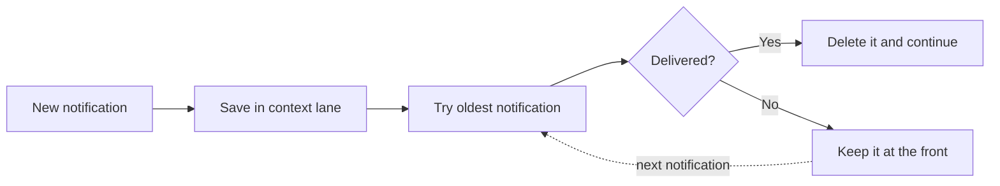

import { Terminology } from '@cbnventures/docusaurus-preset-nova/blocks';

Durable delivery keeps a notification from disappearing when an ntfy <Terminology title="an ntfy instance defined by name, URL, and token" to="/docs/reference/terminology#server">server</Terminology> is temporarily unavailable. Think of it as a small reservoir in front of ntfy: the proxy saves the notification first, then releases saved notifications in order when delivery is possible.

## The Short Version

Every configured <Terminology title="a notification source configuration" to="/docs/reference/terminology#context">context</Terminology> gets its own first-in, first-out delivery lane.

1. The proxy formats a notification and saves it in that context's lane.
2. It starts with the oldest saved notification and attempts delivery.
3. When delivery succeeds, the saved notification is deleted and the next one can proceed.
4. When delivery fails, the notification stays at the front and that lane stops.
5. The next notification for the same context automatically tries the saved notification again before it sends the new one.

There is no timer, background polling job, or manual retry button. A new notification is the retry trigger.



## One Lane Per Context

The lane name is the context's explicit `id` from `config.json`. Contexts do not share a lane, even when they publish to the same topic or ntfy server.

For example, if `synology` is blocked because its ntfy destination is offline, `statuspage` and `seerr` can keep flowing through their own lanes. Later Synology notifications wait behind the failed Synology notification so their order is preserved.

| Context lane | Oldest notification | What happens                  |
|--------------|---------------------|-------------------------------|
| `synology`   | Delivery is failing | This lane waits in FIFO order |
| `statuspage` | Delivery succeeds   | This lane continues normally  |
| `seerr`      | Delivery succeeds   | This lane continues normally  |

This isolation is why the proxy uses one logical Cloudflare Durable Object per context instead of one global queue.

## Delivery Modes

Durable delivery follows the context's existing `mode` setting.

- **`send-once`** — The saved notification is complete as soon as one configured server accepts it. The normal primary-then-fallback order still applies.
- **`send-all`** — The saved notification is complete only after every configured server accepts it.

For `send-all`, the proxy checkpoints each successful server and each successful stage. If one server fails, a later retry skips work already confirmed on the other servers. Split message parts and binary attachments are checkpointed separately for the same reason.

## HTTP Responses

When an HTTP notification is safely saved but cannot finish delivery, the proxy returns HTTP `202`:

```json
{
  "status": "queued"
}
```

This means the proxy accepted responsibility for the notification, not that ntfy has already received it. With `show_response_output` enabled, the response also includes the delivery ID, context, interpreter, and number of notifications still waiting in that context lane.

Failures before the notification is saved still return an error so the original sender can retry. Email delivery uses the same durable lanes, but email processing has no HTTP response.

## Delivery Guarantee

The outbox provides **at-least-once delivery**, not exactly-once delivery.

The proxy saves before sending and only deletes after confirmed success. However, there is an unavoidable edge case: ntfy can accept a request immediately before the Worker stops, leaving no chance to save the success checkpoint. The next trigger must retry because the proxy cannot prove the first request succeeded, so a duplicate is possible.

Each saved notification reuses a stable ntfy `X-Sequence-ID` for every message part and attachment across retries. ntfy clients can treat a repeated sequence as an update to the existing notification instead of displaying another copy. The ntfy server still records an append-only message event for each request, so the proxy does not treat sequence IDs as an exactly-once guarantee. See ntfy's [updating notifications documentation](https://docs.ntfy.sh/publish/#updating-notifications) for the sequence behavior.

## Cloudflare Services and Cost

Durable delivery uses the services already surrounding the Worker deployment plus one Worker-native storage primitive:

- **Cloudflare Workers** continues to run the proxy.
- **SQLite-backed Durable Objects** store each context's notification lane and delivery checkpoints.
- **Workers KV** remains limited to Statuspage incident and component state.
- **Cloudflare Queues, D1, and R2 are not used.**

The generated `wrangler.toml` includes the Durable Object binding and its first SQLite migration automatically. There is no separate database or queue to create and no background retry service consuming resources while notifications are idle.

SQLite-backed Durable Objects are available on Workers Free and Paid plans. On the Free plan, exceeding a daily allowance causes further operations of that type to fail rather than creating an overage charge. Paid accounts can incur charges after their included usage. For a small personal notification proxy, usage follows incoming notifications and retry attempts rather than a continuously running process. Review Cloudflare's current [Durable Objects limits](https://developers.cloudflare.com/durable-objects/platform/limits/) and [pricing](https://developers.cloudflare.com/durable-objects/platform/pricing/) for the allowances on your account.

:::warning
Strict FIFO is intentional. If the oldest notification keeps failing, later notifications in that same context wait behind it. Fixing the ntfy destination does not start a background retry; the next notification for that context triggers the next attempt.
:::
