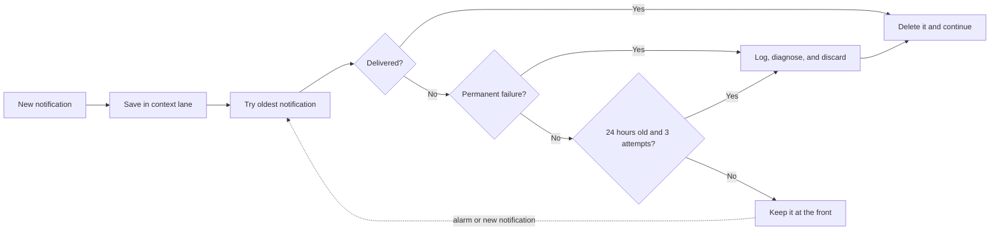

import { Terminology } from '@cbnventures/docusaurus-preset-nova/blocks';

Durable delivery keeps a notification from disappearing when an ntfy <Terminology title="One of your ntfy instances: a name, URL, and token" to="/docs/reference/terminology#ntfy-servers-and-messages">server</Terminology> is temporarily unavailable. Think of it as a small reservoir in front of ntfy: the proxy saves the notification first, then releases saved notifications in order when delivery is possible.

## The Short Version

Every configured <Terminology title="One alert source: its address, interpreter, and topic" to="/docs/reference/terminology#how-it-works">context</Terminology> gets its own first-in, first-out delivery lane for normal notifications.

1. The proxy formats a notification and saves it in that context's lane.
2. It starts with the oldest saved notification and attempts delivery.
3. When delivery succeeds, the saved notification is deleted and the next one can proceed.
4. A transient failure—network status `0`, HTTP 408, HTTP 429, or HTTP 5xx—keeps the notification at the front and schedules one backoff alarm for another attempt.
5. A permanent failure—most HTTP 4xx responses, an invalid saved payload, or a server name that no longer exists—is logged and discarded so the lane can continue.
6. A transient notification is discarded only after it is at least 24 hours old **and** has failed at least three times. Until both conditions are true, incoming notifications cannot age it out by increasing its attempt count.

There is no continuously polling job or manual retry button. A Durable Object alarm retries a transient head with exponential backoff, starting at one minute and capped at one hour. A new notification for the context also asks the lane to drain, while the existing alarm prevents retry timers from piling up.

Error-topic diagnostics are the exception. The proxy sends each `error-debug.json` attachment directly as a one-shot, best-effort alert instead of saving it in the context lane. When the outbox discards a notification and the context has an `error_topic`, that attachment identifies the delivery, reason, HTTP status, attempt count, and age. A rejected diagnostic can be lost, but it can never sit at the head of the lane and block later normal notifications.



## One Lane Per Context

The lane name is the context's explicit `id` from `config.json`. Contexts do not share a lane, even when they publish to the same topic or ntfy server.

For example, if `synology` is blocked because its ntfy destination is offline, `statuspage` and `seerr` can keep flowing through their own lanes. Later Synology notifications wait until the failed Synology notification succeeds or expires after the 24-hour transient-failure window.

| Context lane | Oldest notification | What happens                             |
|--------------|---------------------|------------------------------------------|
| `synology`   | Delivery is failing | This lane retries with one backoff alarm |
| `statuspage` | Delivery succeeds   | This lane continues normally             |
| `seerr`      | Delivery succeeds   | This lane continues normally             |

This isolation is why the proxy uses one logical Cloudflare Durable Object per context instead of one global queue.

## Delivery Modes

Durable delivery follows the context's existing `mode` setting.

- **`send-once`** — The saved notification is complete as soon as one configured server accepts it. The normal primary-then-fallback order still applies.
- **`send-all`** — The saved notification is complete only after every configured server accepts it.

For `send-all`, the proxy checkpoints each successful server and each successful stage. If one server fails, a later retry skips work already confirmed on the other servers. Split message parts and binary attachments are checkpointed separately for the same reason.

## HTTP Responses

When an HTTP notification is safely saved but cannot finish delivery, the proxy returns HTTP `202`:

```json
{
  "status": "queued"
}
```

This means the proxy accepted responsibility for the notification, not that ntfy has already received it. With `show_response_output` enabled, the response also includes the delivery ID, context, interpreter, and number of notifications still waiting in that context lane.

A queued notification can still be discarded immediately for a permanent failure. A transient notification remains queued until delivery succeeds or a failed attempt occurs after both the 24-hour age limit and three-attempt minimum have been reached.

Failures before the notification is saved still return an error so the original sender can retry. Email delivery uses the same durable lanes, but email processing has no HTTP response.

## Delivery Guarantee

The outbox provides durable, age-bounded retries rather than guaranteed eventual or exactly-once delivery.

The proxy saves before sending. Transient failures retry through a single exponential-backoff alarm and are not discarded merely because new posts increase the attempt count. The outbox discards a still-failing transient notification on the first qualifying attempt after it is 24 hours old and has at least three failed attempts. Permanent failures are discarded immediately.

Every discard writes a `delivery_outbox_discarded` log event. If the context has an `error_topic`, the proxy also sends a one-shot `error-debug.json` diagnostic outside the durable lane. A retained transient failure writes `delivery_outbox_retry` instead.

There is also an unavoidable duplicate edge case: ntfy can accept a request immediately before the Worker stops, leaving no chance to save the success checkpoint. The next trigger retries because the proxy cannot prove the first request succeeded.

Each saved notification reuses a stable ntfy `X-Sequence-ID` for every message part and attachment across retries. ntfy clients can treat a repeated sequence as an update to the existing notification instead of displaying another copy. The ntfy server still records an append-only message event for each request, so the proxy does not treat sequence IDs as an exactly-once guarantee. See ntfy's [updating notifications documentation](https://docs.ntfy.sh/publish/#updating-notifications) for the sequence behavior.

## Cloudflare Services and Cost

Durable delivery uses the services already surrounding the Worker deployment plus one Worker-native storage primitive:

- **Cloudflare Workers** continues to run the proxy.
- **SQLite-backed Durable Objects** store each context's notification lane and delivery checkpoints.
- **Workers KV** remains limited to Statuspage incident and component state and session token records.
- **Cloudflare Queues, D1, and R2 are not used.**

The generated `wrangler.toml` includes the Durable Object binding and its first SQLite migration automatically. There is no separate database, queue, or continuously polling retry service to create. Durable Object alarms wake only lanes that have transient work to retry.

SQLite-backed Durable Objects are available on Workers Free and Paid plans. On the Free plan, exceeding a daily allowance causes further operations of that type to fail rather than creating an overage charge. Paid accounts can incur charges after their included usage. For a small personal notification proxy, usage follows incoming notifications and retry attempts rather than a continuously running process. Review Cloudflare's current [Durable Objects limits](https://developers.cloudflare.com/durable-objects/platform/limits/) and [pricing](https://developers.cloudflare.com/durable-objects/platform/pricing/) for the allowances on your account.

:::warning
Strict FIFO is intentional for normal notifications. Later notifications wait behind a transiently failed head until it succeeds or reaches the 24-hour age limit with at least three failed attempts. A permanently failed head is discarded immediately.

After you fix an ntfy destination, the lane resumes on its next scheduled alarm or the next notification for that context. Error-topic diagnostics bypass this lane.
:::
