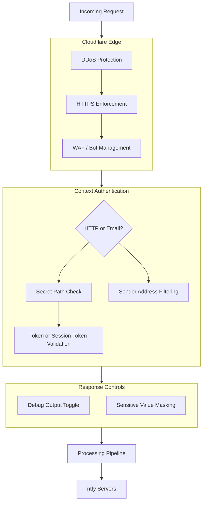

import { Terminology } from '@cbnventures/docusaurus-preset-nova/blocks';

Protect your notification <Terminology title="The steps every webhook or email goes through, in order" to="/docs/reference/terminology#how-it-works">pipeline</Terminology> with <Terminology title="One alert source: its address, interpreter, and topic" to="/docs/reference/terminology#how-it-works">context</Terminology>-level authentication, sensitive value masking, and Cloudflare edge security.



## HTTP Authentication

Each HTTP <Terminology title="One alert source: its address, interpreter, and topic" to="/docs/reference/terminology#how-it-works">context</Terminology> can optionally require a token. When the `token` field is set on a <Terminology title="One alert source: its address, interpreter, and topic" to="/docs/reference/terminology#how-it-works">context</Terminology>, incoming requests must include a matching `Authorization` header.

Supported header formats:

- `Authorization: Bearer {token}` — The standard bearer token format. The `Bearer` prefix is case-sensitive (lowercase `bearer` will not match).
- `Authorization: {token}` — A raw token without the `Bearer` prefix.

If the <Terminology title="One alert source: its address, interpreter, and topic" to="/docs/reference/terminology#how-it-works">context</Terminology> has neither a `token` nor a `session` field, all requests are allowed without authentication. For senders that can't send headers, a [secret path](#secret-paths) keeps the URL itself private.

:::danger
On authentication failure, the <Terminology title="The proxy itself, running on your Cloudflare account" to="/docs/reference/terminology#how-it-works">worker</Terminology> returns HTTP 403. If the <Terminology title="One alert source: its address, interpreter, and topic" to="/docs/reference/terminology#how-it-works">context</Terminology> has an `error_topic` configured and `error_events` includes `"authentication"` (or is omitted), an `error-debug.json` <Terminology title="A file sent along with the notification" to="/docs/reference/terminology#ntfy-servers-and-messages">attachment</Terminology> is sent to that <Terminology title="Where you hear about alerts the proxy couldn't handle" to="/docs/reference/terminology#ntfy-servers-and-messages">topic</Terminology> containing the timestamp, error, <Terminology title="One alert source: its address, interpreter, and topic" to="/docs/reference/terminology#how-it-works">context</Terminology> name and <Terminology title="Turns one app's raw alert into a clean ntfy message" to="/docs/reference/terminology#how-it-works">interpreter</Terminology>, request details (method, URL, headers with the Authorization header value redacted, and Cloudflare properties), response status, and request body.
:::

<details>
<summary>Example error-debug.json (HTTP authentication)</summary>

```json
{
  "timestamp": "2026-04-15T12:00:00.000Z",
  "error": {
    "type": "authentication",
    "message": "Invalid token"
  },
  "context": {
    "name": "My Service",
    "interpreter": "plain-text",
    "stage": "authentication"
  },
  "request": {
    "method": "POST",
    "url": "https://myservice.ntfy.example.com/",
    "headers": {
      "authorization": "REDACTED",
      "content-type": "text/plain",
      "user-agent": "curl/8.0"
    },
    "cf": {
      "country": "US",
      "colo": "SJC"
    }
  },
  "response": {
    "status": 403
  },
  "body": {
    "type": "text",
    "text": "the raw request body"
  }
}
```

The `Authorization` header value is redacted (replaced with `REDACTED`) before sending, and `error.message` is either `Missing Authorization header` or `Invalid token`. Both authentication and interpretation error <Terminology title="A file sent along with the notification" to="/docs/reference/terminology#ntfy-servers-and-messages">attachments</Terminology> include a `body` field with `type` and `json` or `text` sub-fields.

Interpretation error <Terminology title="A file sent along with the notification" to="/docs/reference/terminology#ntfy-servers-and-messages">attachments</Terminology> also add the error's `name`, `stack`, and any schema `issues` to `error`, and they report status `422`.

</details>

## Session Tokens

Session tokens protect a <Terminology title="One alert source: its address, interpreter, and topic" to="/docs/reference/terminology#how-it-works">context</Terminology> whose sender's code is public, like an open-source plugin, where a fixed `token` would be visible to anyone who reads it. Each message needs a fresh <Terminology title="A short-lived, one-use pass a sender gets from /session" to="/docs/reference/terminology#configuration">session token</Terminology>, so copying a URL and posting to it no longer works.

Session tokens work with every <Terminology title="Turns one app's raw alert into a clean ntfy message" to="/docs/reference/terminology#how-it-works">interpreter</Terminology>, because the check runs before the message is interpreted.

### How It Works

1. The sender sends a `POST` or `PUT` to `https://{id}.ntfy.example.com/session`.
2. The <Terminology title="The proxy itself, running on your Cloudflare account" to="/docs/reference/terminology#how-it-works">worker</Terminology> replies with a signed <Terminology title="A short-lived, one-use pass a sender gets from /session" to="/docs/reference/terminology#configuration">session token</Terminology>.
3. The sender posts its message with `Authorization: Bearer {token}` from the same IP address.
4. The <Terminology title="The proxy itself, running on your Cloudflare account" to="/docs/reference/terminology#how-it-works">worker</Terminology> accepts the message only when it signed the token for this <Terminology title="One alert source: its address, interpreter, and topic" to="/docs/reference/terminology#how-it-works">context</Terminology>, the token hasn't expired, the address matches, and the token wasn't used before.

```json title="Response from /session"
{
  "status": "success",
  "token": "eyJhbGciOiJIUzI1NiIsInR5cCI6IkpXVCJ9.eyJhdWQiOi...",
  "expires_in": 300
}
```

### Limits

- **One message per token** — Each <Terminology title="A short-lived, one-use pass a sender gets from /session" to="/docs/reference/terminology#configuration">session token</Terminology> works once, so a captured request can't be sent again after the first use is recorded. KV checks and writes aren't atomic, so two requests sent at the same instant with one token can both pass.
- **Short lifetime** — Tokens expire after `ttl_seconds`, which defaults to 300 seconds.
- **Per-address limit** — Each IP address can get `max_per_hour` tokens per hour, which defaults to 10. Further `/session` requests get HTTP 429. The count lives in KV, so a burst of simultaneous requests can slip a few past the limit.
- **Storage** — Counting and spending tokens uses the <Terminology title="Workers storage that deploy creates and binds for you" to="/docs/reference/terminology#cloudflare-setup">KV namespace</Terminology> that `deploy` creates. Without it, `/session` returns HTTP 503.

### Rejections

A rejected message gets the same HTTP 403 and `error-debug.json` behavior as a wrong `token`. The `error.message` names the reason:

- `Missing Authorization header`
- `Invalid session token`
- `Expired session token`
- `Session token was issued to another address`
- `Session token was already used`
- `Session storage is unavailable`

:::info
A public sender's code still shows how to ask for tokens, so anyone can request them the same way. Each token is single-use, short-lived, tied to one address, and capped per hour, which keeps forged traffic small and easy to block.
:::

:::warning
A <Terminology title="One alert source: its address, interpreter, and topic" to="/docs/reference/terminology#how-it-works">context</Terminology> can set `token` or `session`, not both. On a <Terminology title="One alert source: its address, interpreter, and topic" to="/docs/reference/terminology#how-it-works">context</Terminology> without `session`, a `POST` or `PUT` to `/session` returns HTTP 404, while a `GET` still shows the landing page.
:::

:::tip
If a Cloudflare custom rule blocks every path except `/` on your proxy's hostnames, add `/session` to the allowed paths, as the [block rule](#block-rule) below does. Otherwise Cloudflare answers `/session` with HTTP 403 before the request reaches the <Terminology title="The proxy itself, running on your Cloudflare account" to="/docs/reference/terminology#how-it-works">worker</Terminology>, and senders never get a token.
:::

## Secret Paths

A <Terminology title="An unguessable URL path only your sender knows" to="/docs/reference/terminology#configuration">secret path</Terminology> protects a <Terminology title="One alert source: its address, interpreter, and topic" to="/docs/reference/terminology#how-it-works">context</Terminology> whose sender can't send headers or signatures, such as Statuspage, so it can't use a `token`. Every <Terminology title="One alert source: its address, interpreter, and topic" to="/docs/reference/terminology#how-it-works">context</Terminology> hostname shows up in public certificate logs, and the <Terminology title="An unguessable URL path only your sender knows" to="/docs/reference/terminology#configuration">secret path</Terminology> keeps scanners that find it from posting.

### How It Works

1. Set `secret_path` on the HTTP <Terminology title="One alert source: its address, interpreter, and topic" to="/docs/reference/terminology#how-it-works">context</Terminology>, or answer yes to **Use a secret URL path?** in the CLI, which generates a 48-character one and prints the full URL.
2. Give the sender the full URL, `https://{id}.ntfy.example.com/inbound/{secret_path}`. Every <Terminology title="An unguessable URL path only your sender knows" to="/docs/reference/terminology#configuration">secret path</Terminology> sits under `/inbound/`, so one [block rule](#block-rule) covers all of them. One trailing slash is accepted.
3. The <Terminology title="The proxy itself, running on your Cloudflare account" to="/docs/reference/terminology#how-it-works">worker</Terminology> compares the path in constant time before it checks a token, reads the body, or sends anything.

### Behavior

- **Format** — 32 to 128 lowercase letters and digits. Lowercase keeps the URL working when a sender stores it in lowercase.
- **Wrong paths** — Any other path, including `/`, `/session`, and another `/inbound/` path, gets the same HTTP 404 and body as a hostname with no <Terminology title="One alert source: its address, interpreter, and topic" to="/docs/reference/terminology#how-it-works">context</Terminology>. No error notification goes out, so a probe can't tell the <Terminology title="One alert source: its address, interpreter, and topic" to="/docs/reference/terminology#how-it-works">context</Terminology> exists.
- **Error notifications** — When a request on the <Terminology title="An unguessable URL path only your sender knows" to="/docs/reference/terminology#configuration">secret path</Terminology> later fails, the `error-debug.json` <Terminology title="A file sent along with the notification" to="/docs/reference/terminology#ntfy-servers-and-messages">attachment</Terminology> shows the path as `/REDACTED`.
- **With a token** — `secret_path` and `token` can be combined, so a sender that can send headers needs both.

:::warning
A <Terminology title="One alert source: its address, interpreter, and topic" to="/docs/reference/terminology#how-it-works">context</Terminology> can't set both `secret_path` and `session`, because <Terminology title="A short-lived, one-use pass a sender gets from /session" to="/docs/reference/terminology#configuration">session tokens</Terminology> are issued on their own path.
:::

## Email Authentication

Email <Terminology title="One alert source: its address, interpreter, and topic" to="/docs/reference/terminology#how-it-works">contexts</Terminology> use the `allowed_from` field to control which senders can trigger notifications.

- **Exact match** — `user@example.com` allows only that address.
- **Wildcard** — `*@example.com` allows any sender from that domain.
- **List** — `["*@githubstatus.com", "alerts@example.com"]` allows a sender that matches any entry.
- **Not set** — All senders are allowed.

Matching is case-insensitive. If the <Terminology title="One alert source: its address, interpreter, and topic" to="/docs/reference/terminology#how-it-works">context</Terminology> has an `error_topic` configured and `error_events` includes `"authentication"` (or is omitted), unauthorized emails send an `error-debug.json` <Terminology title="A file sent along with the notification" to="/docs/reference/terminology#ntfy-servers-and-messages">attachment</Terminology> to that <Terminology title="Where you hear about alerts the proxy couldn't handle" to="/docs/reference/terminology#ntfy-servers-and-messages">topic</Terminology>.

<details>
<summary>Example error-debug.json (email authentication)</summary>

```json
{
  "timestamp": "2026-04-15T12:00:00.000Z",
  "error": {
    "type": "authentication",
    "message": "Sender domain not allowed"
  },
  "context": {
    "name": "pfSense Alerts",
    "interpreter": "pfsense",
    "stage": "authentication"
  },
  "email": {
    "from": "unknown@example.com",
    "to": "pfsense@ntfy.example.com",
    "subject": "Alert notification",
    "textBody": "the email's text body"
  }
}
```

The `error.message` is `Sender domain not allowed` when every entry is a wildcard, `Sender not allowed` when any entry is an exact address, or `Missing sender address`. Email interpretation errors use the same `email` object and also add the error's `name`, `stack`, and any schema `issues`.

</details>

## Sensitive Value Masking

The <Terminology title="The proxy itself, running on your Cloudflare account" to="/docs/reference/terminology#how-it-works">worker</Terminology> masks sensitive values in the <Terminology title="Open a context's URL in a browser to see it's up" to="/docs/reference/terminology#configuration">landing page</Terminology> debug section when `show_response_output` is enabled.

- **<Terminology title="One of your ntfy instances: a name, URL, and token" to="/docs/reference/terminology#ntfy-servers-and-messages">Server</Terminology> tokens** — Replaced with `***`.
- **<Terminology title="One of your ntfy instances: a name, URL, and token" to="/docs/reference/terminology#ntfy-servers-and-messages">Server</Terminology> URLs** — Replaced with `***`.
- **<Terminology title="The domain every context subdomain lives under" to="/docs/reference/terminology#cloudflare-setup">Base domain</Terminology>** — Replaced with `***`.
- **<Terminology title="One alert source: its address, interpreter, and topic" to="/docs/reference/terminology#how-it-works">Context</Terminology> IDs and <Terminology title="The ntfy channel your phone subscribes to for alerts" to="/docs/reference/terminology#ntfy-servers-and-messages">topics</Terminology>** — Replaced with `***`.
- **<Terminology title="One alert source: its address, interpreter, and topic" to="/docs/reference/terminology#how-it-works">Context</Terminology> tokens, `session`, `secret_path`, and `allowed_from`** — Replaced with `***` when present.
- **<Terminology title="Where you hear about alerts the proxy couldn't handle" to="/docs/reference/terminology#ntfy-servers-and-messages">Error topics</Terminology>** — Replaced with `***` when present.

This masking applies to the collapsible debug section on the GET <Terminology title="Open a context's URL in a browser to see it's up" to="/docs/reference/terminology#configuration">landing page</Terminology>. The POST/PUT JSON response includes <Terminology title="One alert source: its address, interpreter, and topic" to="/docs/reference/terminology#how-it-works">context</Terminology> name, <Terminology title="Turns one app's raw alert into a clean ntfy message" to="/docs/reference/terminology#how-it-works">interpreter</Terminology>, and <Terminology title="One of your ntfy instances: a name, URL, and token" to="/docs/reference/terminology#ntfy-servers-and-messages">server</Terminology> results only when `show_response_output` is enabled.

## Debug Output

The `show_response_output` setting controls whether detailed information is included in responses.

- **Enabled** — POST/PUT responses include <Terminology title="One alert source: its address, interpreter, and topic" to="/docs/reference/terminology#how-it-works">context</Terminology> name, <Terminology title="Turns one app's raw alert into a clean ntfy message" to="/docs/reference/terminology#how-it-works">interpreter</Terminology>, per-<Terminology title="One of your ntfy instances: a name, URL, and token" to="/docs/reference/terminology#ntfy-servers-and-messages">server</Terminology> delivery results, and message details. The GET <Terminology title="Open a context's URL in a browser to see it's up" to="/docs/reference/terminology#configuration">landing page</Terminology> shows a collapsible debug section with the masked config. Useful during initial setup.
- **Disabled** — POST/PUT responses include only the delivery status (plus `fallback_note` when a fallback delivered), and the GET <Terminology title="Open a context's URL in a browser to see it's up" to="/docs/reference/terminology#configuration">landing page</Terminology> leaves out the debug section. Recommended for production.

Visiting any <Terminology title="One alert source: its address, interpreter, and topic" to="/docs/reference/terminology#how-it-works">context</Terminology> URL in a browser (GET request) shows a <Terminology title="Open a context's URL in a browser to see it's up" to="/docs/reference/terminology#configuration">landing page</Terminology> instead of processing a notification. When `show_response_output` is enabled, the <Terminology title="Open a context's URL in a browser to see it's up" to="/docs/reference/terminology#configuration">landing page</Terminology> includes a collapsible section with the full configuration, with sensitive values masked.

When disabled, it shows only the project logo and name, a short description, an "Operational" status badge, links to the documentation and the GitHub repository, and an "A CBN Ventures project" footer.

## Cloudflare Edge Protection

Running on Cloudflare Workers provides several security benefits at the edge.

- **Origin IP shielding** — Your ntfy <Terminology title="One of your ntfy instances: a name, URL, and token" to="/docs/reference/terminology#ntfy-servers-and-messages">server</Terminology> IPs are never exposed to webhook senders.
- **HTTPS enforcement** — HTTP requests are automatically redirected to HTTPS via 301 (except on localhost for local development).
- **DDoS protection** — Cloudflare's built-in DDoS mitigation applies to all traffic.

## WAF Configuration

Cloudflare's bot protection can block legitimate webhooks. You may need to adjust these settings.

1. **<Terminology title="A Cloudflare setting that can 403 your webhooks" to="/docs/reference/terminology#cloudflare-setup">Bot Fight Mode</Terminology>** (free plan) — Disable this in **Dashboard > Security > Bots** if automated requests are being blocked with 403 responses. <Terminology title="A Cloudflare setting that can 403 your webhooks" to="/docs/reference/terminology#cloudflare-setup">Bot Fight Mode</Terminology> cannot be bypassed with WAF rules.
2. **WAF skip rule** (Pro+) — Pro plans and above use <Terminology title="Bot Fight Mode's paid-plan variant, skippable by a WAF rule" to="/docs/reference/terminology#cloudflare-setup">Super Bot Fight Mode</Terminology>, which can be skipped. Create a custom rule that skips <Terminology title="Bot Fight Mode's paid-plan variant, skippable by a WAF rule" to="/docs/reference/terminology#cloudflare-setup">Super Bot Fight Mode</Terminology> for your proxy's hostnames:
   - If: `(http.host contains "ntfy.example.com" and not http.request.headers["sec-fetch-mode"] eq "navigate")`
   - Then: Skip all <Terminology title="Bot Fight Mode's paid-plan variant, skippable by a WAF rule" to="/docs/reference/terminology#cloudflare-setup">Super Bot Fight Mode</Terminology> rules.
3. **Configuration rule** — Set a custom filter to match your proxy hostnames, disable Browser Integrity Check, and set Security Level to "Essentially Off".

:::warning
<Terminology title="A Cloudflare setting that can 403 your webhooks" to="/docs/reference/terminology#cloudflare-setup">Bot Fight Mode</Terminology> cannot be skipped via WAF rules on any plan. The skip rule above targets <Terminology title="Bot Fight Mode's paid-plan variant, skippable by a WAF rule" to="/docs/reference/terminology#cloudflare-setup">Super Bot Fight Mode</Terminology>, which is available on Pro plans and above. Free plan users will need to disable <Terminology title="A Cloudflare setting that can 403 your webhooks" to="/docs/reference/terminology#cloudflare-setup">Bot Fight Mode</Terminology> entirely if it blocks webhook traffic.
:::

### Block Rule

The proxy only answers on `/`, on `/session` for <Terminology title="A short-lived, one-use pass a sender gets from /session" to="/docs/reference/terminology#configuration">session tokens</Terminology>, and under `/inbound/` for <Terminology title="An unguessable URL path only your sender knows" to="/docs/reference/terminology#configuration">secret paths</Terminology>. A custom rule that blocks everything else stops scanners at Cloudflare's edge, so they never use up <Terminology title="The proxy itself, running on your Cloudflare account" to="/docs/reference/terminology#how-it-works">worker</Terminology> requests. The rule works on the free plan.

1. Open **Dashboard > your domain > Security > Security rules** and select **Create rule > Custom rules**.
2. Name the rule, for example `Reverse Proxy for ntfy`.
3. Select **Edit expression** and paste the expression below. Replace `ntfy.example.com` with your `base_domain`.
4. Set **Choose action** to **Block**.
5. Set **Select order** to **First**, then select **Deploy**.

```text title="Expression"
ends_with(http.host, "ntfy.example.com") and (
  (not http.request.uri.path in {"/" "/session"} and not starts_with(http.request.uri.path, "/inbound/"))
  or (len(http.request.uri.query) > 0)
  or (len(http.request.headers["next-action"]) > 0)
)
```

Each line blocks one kind of request on your proxy's hostnames:

- **Other paths** — Any path besides `/`, `/session`, and paths under `/inbound/`, such as `/wp-login.php` or `/.env`. Requests under `/inbound/` reach the <Terminology title="The proxy itself, running on your Cloudflare account" to="/docs/reference/terminology#how-it-works">worker</Terminology>, which answers HTTP 404 unless the full path matches a <Terminology title="An unguessable URL path only your sender knows" to="/docs/reference/terminology#configuration">secret path</Terminology>.
- **Query strings** — Any URL with `?` parameters, which no sender needs.
- **`next-action` header** — Probes aimed at Next.js server actions, which the proxy doesn't use.

To check the rule, send a `POST` to `https://{id}.ntfy.example.com/session` and to any other path, such as `/test`. The `/session` request should get an answer from the <Terminology title="The proxy itself, running on your Cloudflare account" to="/docs/reference/terminology#how-it-works">worker</Terminology>, and `/test` should get Cloudflare's HTTP 403 block page.

## HTTPS Enforcement

The <Terminology title="The proxy itself, running on your Cloudflare account" to="/docs/reference/terminology#how-it-works">worker</Terminology> automatically redirects HTTP requests to HTTPS using a 301 redirect. This applies to all requests where the hostname includes the configured `base_domain`, except those on `localhost` (for local development with `wrangler dev`).

## Best Practices

- Set a unique `token` on each HTTP <Terminology title="One alert source: its address, interpreter, and topic" to="/docs/reference/terminology#how-it-works">context</Terminology> that receives traffic from the public internet.
- Use `session` instead of `token` when the sender's code is public, so a token copied from that code can't be used to post.
- Use `secret_path` for senders that can't send headers, such as Statuspage, so scanners that find the hostname get a plain HTTP 404.
- Use `allowed_from` wildcards on email <Terminology title="One alert source: its address, interpreter, and topic" to="/docs/reference/terminology#how-it-works">contexts</Terminology> to restrict senders to expected domains.
- Disable `show_response_output` in production to minimize information exposure.
- Disable `show_visitor_info` unless you need IP and location details in notifications.
- Add the [block rule](#block-rule) so requests to paths the proxy doesn't serve stop at Cloudflare.
- On Pro plans and above, set up a <Terminology title="Bot Fight Mode's paid-plan variant, skippable by a WAF rule" to="/docs/reference/terminology#cloudflare-setup">Super Bot Fight Mode</Terminology> skip rule rather than disabling bot protection entirely.
- Use `error_topic` only with ntfy <Terminology title="One of your ntfy instances: a name, URL, and token" to="/docs/reference/terminology#ntfy-servers-and-messages">servers</Terminology> you control — error notifications include full <Terminology title="One alert source: its address, interpreter, and topic" to="/docs/reference/terminology#how-it-works">context</Terminology> details, request metadata, and email content as unmasked JSON <Terminology title="A file sent along with the notification" to="/docs/reference/terminology#ntfy-servers-and-messages">attachments</Terminology>.
