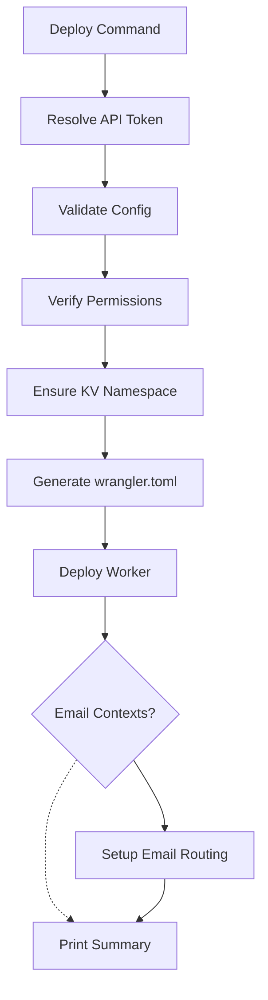

import { Terminology } from '@cbnventures/docusaurus-preset-nova/blocks';

Deploy Reverse Proxy for ntfy to Cloudflare Workers and configure DNS, SSL, and <Terminology title="Workers route treating the hostname's first label as subdomain" to="/docs/reference/terminology#custom-domain-route">custom domain routes</Terminology>.

## Cloudflare Requirements

- **Cloudflare account** — Free or paid. The deployment uses Workers and SQLite-backed Durable Objects; current plan limits and pricing apply.
- **Registered domain** — You need a domain managed by Cloudflare DNS. Cloudflare Registrar offers domains at cost with no markup.
- **Cloudflare API token** — Deploy uses a Cloudflare API token with the permissions listed below, both for its own Cloudflare calls and to run Wrangler (Cloudflare's deployment CLI). It reads `CLOUDFLARE_API_TOKEN` from your environment or `.env` file, and **Deploy** in the interactive menu walks you through creating one.

## How Deployment Works

The deploy command runs these steps in sequence:

1. **Resolve API token** — Reads `CLOUDFLARE_API_TOKEN` from the environment or `.env`. If it's missing or invalid, **Deploy** in the interactive menu prompts for a new one and saves it, while `nrp deploy` stops with an error.
2. **Validate** — Checks config integrity (schema, <Terminology title="an ntfy instance defined by name, URL, and token" to="/docs/reference/terminology#server">server</Terminology> references, duplicate IDs).
3. **Verify permissions** — Confirms the API token has access to Workers Scripts, Workers Routes, Workers KV Storage, and (if email <Terminology title="a notification source configuration" to="/docs/reference/terminology#context">contexts</Terminology> exist) Email Routing Rules.
4. **Ensure <Terminology title="Cloudflare Workers KV store for dedup state" to="/docs/reference/terminology#kv-namespace">KV namespace</Terminology>** — Creates or locates a Cloudflare Workers <Terminology title="Cloudflare Workers KV store for dedup state" to="/docs/reference/terminology#kv-namespace">KV namespace</Terminology> for Statuspage deduplication. The namespace ID is automatically passed to the <Terminology title="Cloudflare Workers config file generated from config.json" to="/docs/reference/terminology#wranglertoml">wrangler.toml</Terminology> generator.
5. **Generate** — Produces `wrangler.toml` next to your `config.json` with all routes and bindings, plus a copy of your config in `.wrangler/ntfy-reverse-proxy/` beside it that ships inside the <Terminology title="Cloudflare-hosted entry point that runs the pipeline" to="/docs/reference/terminology#worker">worker</Terminology>.
6. **Deploy <Terminology title="Cloudflare-hosted entry point that runs the pipeline" to="/docs/reference/terminology#worker">worker</Terminology>** — Invokes `wrangler deploy` to push the <Terminology title="Cloudflare-hosted entry point that runs the pipeline" to="/docs/reference/terminology#worker">worker</Terminology> to Cloudflare.
7. **Setup email routing** — If email <Terminology title="a notification source configuration" to="/docs/reference/terminology#context">contexts</Terminology> exist, automatically configures <Terminology title="Cloudflare feature that forwards email to the Worker" to="/docs/reference/terminology#cloudflare-email-routing">Cloudflare Email Routing</Terminology> rules to forward emails to the <Terminology title="Cloudflare-hosted entry point that runs the pipeline" to="/docs/reference/terminology#worker">worker</Terminology>.
8. **Print summary** — Displays deployed <Terminology title="a notification source configuration" to="/docs/reference/terminology#context">context</Terminology> URLs and email addresses.

## Generated wrangler.toml

The generated file includes:

- **Routes** — Each HTTP <Terminology title="a notification source configuration" to="/docs/reference/terminology#context">context</Terminology> gets a <Terminology title="Workers route treating the hostname's first label as subdomain" to="/docs/reference/terminology#custom-domain-route">custom domain route</Terminology>: `{context-id}.{base_domain}`. Cloudflare automatically creates DNS records for <Terminology title="Workers route treating the hostname's first label as subdomain" to="/docs/reference/terminology#custom-domain-route">custom domain routes</Terminology>.
- **Email routing** — Comments showing which email addresses need to be configured in <Terminology title="Cloudflare feature that forwards email to the Worker" to="/docs/reference/terminology#cloudflare-email-routing">Cloudflare Email Routing</Terminology> for email <Terminology title="a notification source configuration" to="/docs/reference/terminology#context">contexts</Terminology>.
- **Bundled config** — `main` points to a generated entry in `.wrangler/ntfy-reverse-proxy/` that ships your config inside the <Terminology title="Cloudflare-hosted entry point that runs the pipeline" to="/docs/reference/terminology#worker">worker</Terminology> instead of as environment variables, which Cloudflare caps at 5 KB each (about 20 <Terminology title="a notification source configuration" to="/docs/reference/terminology#context">contexts</Terminology>). The <Terminology title="Cloudflare-hosted entry point that runs the pipeline" to="/docs/reference/terminology#worker">worker</Terminology> checks the config once when it starts instead of on every request and email.
- **Durable Object** — Binds the SQLite-backed `DELIVERY_OUTBOX` class and declares its initial migration. This provides one logical FIFO lane per context without Cloudflare Queues, D1, or R2.
- **<Terminology title="Cloudflare Workers KV store for dedup state" to="/docs/reference/terminology#kv-namespace">KV namespace</Terminology>** — Deploy binds the namespace it found or created in step 4 (used by the Statuspage <Terminology title="module that transforms a payload into a notification" to="/docs/reference/terminology#interpreter">interpreter</Terminology> for deduplication). `nrp generate` leaves this binding out.

The Durable Object does not need a separate provisioning step. It is created through the generated binding and migration when Wrangler deploys the Worker. See [Durable Delivery](/docs/features/durable-delivery/) for retry behavior and cost considerations.

:::warning
`wrangler.toml` and the `.wrangler/` folder are gitignored because they contain your <Terminology title="a notification source configuration" to="/docs/reference/terminology#context">context</Terminology> IDs and a copy of your config with its tokens. Do not commit them to version control.
:::

## DNS and SSL

After deployment:

- Cloudflare automatically creates DNS records for <Terminology title="Workers route treating the hostname's first label as subdomain" to="/docs/reference/terminology#custom-domain-route">custom domain routes</Terminology>. Propagation typically takes a few minutes.
- SSL certificates are provisioned automatically by Cloudflare. This can take up to 15 minutes.
- Your SSL/TLS mode should be set to "Full" or "Full (strict)" in the Cloudflare dashboard.

## Custom Domain Routes

Routes use `custom_domain = true`, meaning the subdomain is the first part of the hostname. Traditional Cloudflare routes (with `custom_domain = false`) are not supported because the <Terminology title="Cloudflare-hosted entry point that runs the pipeline" to="/docs/reference/terminology#worker">worker</Terminology> matches the hostname's subdomain against <Terminology title="a notification source configuration" to="/docs/reference/terminology#context">context</Terminology> IDs.

## Configuring Your ntfy Servers

For the proxy to work correctly, each ntfy <Terminology title="an ntfy instance defined by name, URL, and token" to="/docs/reference/terminology#server">server</Terminology> should have:

- `base-url` set to the <Terminology title="an ntfy instance defined by name, URL, and token" to="/docs/reference/terminology#server">server</Terminology>'s public URL
- `behind-proxy` set to `true`
- `attachment-cache-dir` configured if you use an <Terminology title="optional topic that receives failure notifications" to="/docs/reference/terminology#error-topic">error topic</Terminology>, because the proxy sends error details as an `error-debug.json` <Terminology title="a binary file delivered alongside a notification" to="/docs/reference/terminology#attachment">attachment</Terminology>. Without this, ntfy cannot store uploaded files.

The proxy automatically splits messages exceeding 4000 UTF-8 bytes into <Terminology title="splits message bodies over 4000 UTF-8 bytes into parts" to="/docs/reference/terminology#smart-split">numbered parts</Terminology>. This is handled by the proxy, not the ntfy <Terminology title="an ntfy instance defined by name, URL, and token" to="/docs/reference/terminology#server">server</Terminology>.

:::tip
ntfy's default attachment limits are: 15 MB per file (`attachment-file-size-limit`), 5 GB total storage (`attachment-total-size-limit`), and 3-hour expiry (`attachment-expiry-duration`). Adjust these based on your storage capacity and retention needs. Refer to the [ntfy self-hosting documentation](https://docs.ntfy.sh/config/) for full configuration options.
:::
