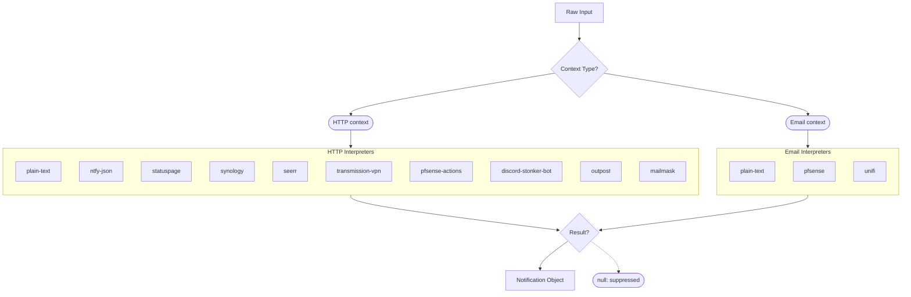

import { Terminology } from '@cbnventures/docusaurus-preset-nova/blocks';

<Terminology title="Turns one app's raw alert into a clean ntfy message" to="/docs/reference/terminology#how-it-works">Interpreters</Terminology> transform raw webhook payloads and email content into standardized ntfy notifications.

## How Interpreters Work

When a request or email arrives, the <Terminology title="The steps every webhook or email goes through, in order" to="/docs/reference/terminology#how-it-works">pipeline</Terminology> invokes the <Terminology title="One alert source: its address, interpreter, and topic" to="/docs/reference/terminology#how-it-works">context</Terminology>'s configured <Terminology title="Turns one app's raw alert into a clean ntfy message" to="/docs/reference/terminology#how-it-works">interpreter</Terminology>. The <Terminology title="Turns one app's raw alert into a clean ntfy message" to="/docs/reference/terminology#how-it-works">interpreter</Terminology> receives the raw input (string, JSON object, or binary) and returns a result with a `notification` object (title, body, priority, tags, icon, actions, markdown) and an optional `attachment` at the same level (not inside the notification).

The `filename` field accompanies the <Terminology title="A file sent along with the notification" to="/docs/reference/terminology#ntfy-servers-and-messages">attachment</Terminology>. The `plain-text` <Terminology title="Turns one app's raw alert into a clean ntfy message" to="/docs/reference/terminology#how-it-works">interpreter</Terminology> returns a binary request body as an attachment, while an <Terminology title="Where you hear about alerts the proxy couldn't handle" to="/docs/reference/terminology#ntfy-servers-and-messages">error topic</Terminology> sends its diagnostic data as `error-debug.json`.

- If an <Terminology title="Turns one app's raw alert into a clean ntfy message" to="/docs/reference/terminology#how-it-works">interpreter</Terminology> returns `null`, the notification is suppressed (useful for filtering duplicate or irrelevant events).
- If interpretation fails, the <Terminology title="The steps every webhook or email goes through, in order" to="/docs/reference/terminology#how-it-works">pipeline</Terminology> returns HTTP 422 for a request (an email has no HTTP response) and optionally forwards the error to the <Terminology title="One alert source: its address, interpreter, and topic" to="/docs/reference/terminology#how-it-works">context</Terminology>'s `error_topic`.

HTML is automatically stripped from all notification bodies after interpretation.

## Available Interpreters

| Interpreter                                                      | Input Type | Best For                                                             |
|------------------------------------------------------------------|------------|----------------------------------------------------------------------|
| [`plain-text`](/docs/interpreters/plain-text/)                   | Any        | Generic webhooks, simple text notifications, testing                 |
| [`ntfy-json`](/docs/interpreters/ntfy-json/)                     | JSON       | Services that can send structured ntfy-compatible payloads           |
| [`statuspage`](/docs/interpreters/statuspage/)                   | JSON       | Statuspage.io incident and component update webhooks                 |
| [`synology`](/docs/interpreters/synology/)                       | JSON       | Synology DSM webhook notifications                                   |
| [`seerr`](/docs/interpreters/seerr/)                             | JSON       | Seerr media request and issue notifications                          |
| [`transmission-vpn`](/docs/interpreters/transmission-vpn/)       | JSON       | Transmission VPN alerts, such as a dropped VPN or a finished torrent |
| [`pfsense-actions`](/docs/interpreters/pfsense-actions/)         | JSON       | pfSense Actions alerts, such as pfSense going unreachable            |
| [`discord-stonker-bot`](/docs/interpreters/discord-stonker-bot/) | JSON       | Discord Stonker Bot alerts, such as a lost Discord connection        |
| [`outpost`](/docs/interpreters/outpost/)                         | JSON       | Outpost alerts, such as updated containers or a failed update        |
| [`mailmask`](/docs/interpreters/mailmask/)                       | JSON       | Mailmask refused-message and notifier test alerts                    |
| [`pfsense`](/docs/interpreters/pfsense/)                         | Email      | pfSense firewall notification emails                                 |
| [`unifi`](/docs/interpreters/unifi/)                             | Email      | UniFi Network controller notification emails                         |

## Choosing an Interpreter

- For services that send raw text or unstructured payloads, use `plain-text`.
- For services where you control the payload format, use `ntfy-json` to send pre-formatted notifications with full control over title, priority, tags, and other fields.
- For the specific services listed above, use the dedicated <Terminology title="Turns one app's raw alert into a clean ntfy message" to="/docs/reference/terminology#how-it-works">interpreter</Terminology> to get formatted titles, priority inference, and contextual tags.
- If you need email-to-ntfy forwarding from pfSense or UniFi, use their respective <Terminology title="Turns one app's raw alert into a clean ntfy message" to="/docs/reference/terminology#how-it-works">interpreters</Terminology> with an email <Terminology title="One alert source: its address, interpreter, and topic" to="/docs/reference/terminology#how-it-works">context</Terminology>.
- For alerts from Transmission VPN, pfSense Actions, Discord Stonker Bot, Outpost, or Mailmask, use the <Terminology title="Turns one app's raw alert into a clean ntfy message" to="/docs/reference/terminology#how-it-works">interpreter</Terminology> named after the app, and choose **ntfy-reverse-proxy** as the destination's service on the app's **Notifications** page.

:::tip
If your webhook does not perfectly match the expected shape, try the dedicated <Terminology title="Turns one app's raw alert into a clean ntfy message" to="/docs/reference/terminology#how-it-works">interpreter</Terminology> first — most have lenient parsing. If it fails with 422, fall back to `plain-text` to see the raw payload, then consider `ntfy-json` if you can normalize the format on the source side.
:::

## Notification Suppression

Most <Terminology title="Turns one app's raw alert into a clean ntfy message" to="/docs/reference/terminology#how-it-works">interpreters</Terminology> always return a notification. Statuspage can return `null`, which suppresses the notification:

- **`statuspage`** — Component-only updates without an incident and incident updates already sent (detected through KV).

Malformed JSON is not suppression: `statuspage` and `ntfy-json` both fail with HTTP 422, allowing the configured <Terminology title="Where you hear about alerts the proxy couldn't handle" to="/docs/reference/terminology#ntfy-servers-and-messages">error topic</Terminology> to report the problem. See [Statuspage](/docs/interpreters/statuspage/) and [ntfy JSON](/docs/interpreters/ntfy-json/) for details.

## Interpreter Availability by Context Type

The interactive CLI menu filters the <Terminology title="Turns one app's raw alert into a clean ntfy message" to="/docs/reference/terminology#how-it-works">interpreter</Terminology> list based on <Terminology title="One alert source: its address, interpreter, and topic" to="/docs/reference/terminology#how-it-works">context</Terminology> type:

- **HTTP <Terminology title="One alert source: its address, interpreter, and topic" to="/docs/reference/terminology#how-it-works">contexts</Terminology>** — `plain-text`, `ntfy-json`, `seerr`, `synology`, `statuspage`, `transmission-vpn`, `pfsense-actions`, `discord-stonker-bot`, `outpost`, `mailmask`
- **Email <Terminology title="One alert source: its address, interpreter, and topic" to="/docs/reference/terminology#how-it-works">contexts</Terminology>** — `plain-text`, `pfsense`, `unifi`

:::info
The config schema allows any of the 12 <Terminology title="Turns one app's raw alert into a clean ntfy message" to="/docs/reference/terminology#how-it-works">interpreters</Terminology> for either type, so you can assign any <Terminology title="Turns one app's raw alert into a clean ntfy message" to="/docs/reference/terminology#how-it-works">interpreter</Terminology> to any <Terminology title="One alert source: its address, interpreter, and topic" to="/docs/reference/terminology#how-it-works">context</Terminology> via direct config editing.
:::
