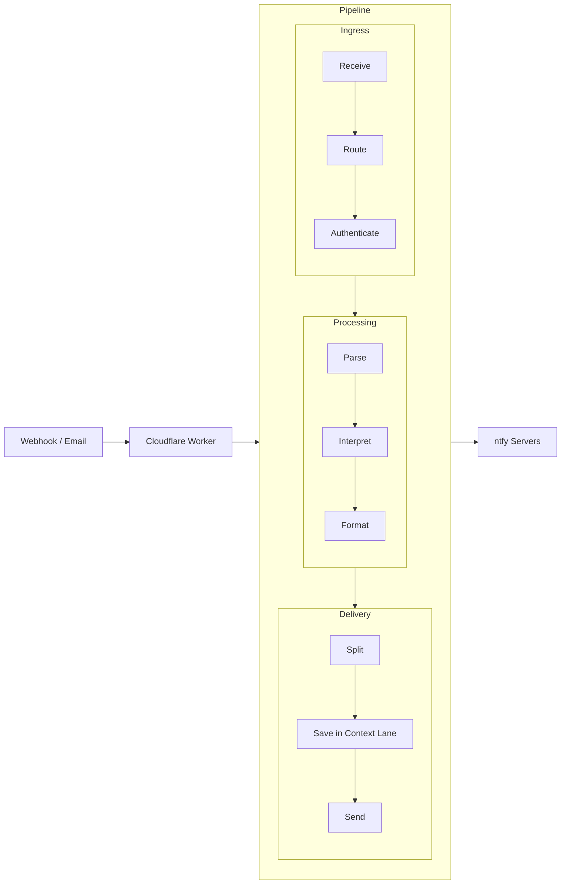

import { Terminology } from '@cbnventures/docusaurus-preset-nova/blocks';

**Reverse Proxy for ntfy** receives webhooks and emails at the edge, transforms them with purpose-built <Terminology title="Turns one app's raw alert into a clean ntfy message" to="/docs/reference/terminology#how-it-works">interpreters</Terminology>, and delivers formatted push notifications to self-hosted ntfy <Terminology title="One of your ntfy instances: a name, URL, and token" to="/docs/reference/terminology#ntfy-servers-and-messages">servers</Terminology>.

## What Is This?

**Reverse Proxy for ntfy** is a Cloudflare <Terminology title="The proxy itself, running on your Cloudflare account" to="/docs/reference/terminology#how-it-works">Worker</Terminology> that sits between webhook sources and your self-hosted [ntfy](https://ntfy.sh) <Terminology title="One of your ntfy instances: a name, URL, and token" to="/docs/reference/terminology#ntfy-servers-and-messages">servers</Terminology>. It receives HTTP webhooks and emails, transforms them with purpose-built <Terminology title="Turns one app's raw alert into a clean ntfy message" to="/docs/reference/terminology#how-it-works">interpreters</Terminology>, and delivers formatted push notifications to one or more ntfy instances.

## Key Capabilities

- **Webhook-to-ntfy routing** — Accepts POST/PUT requests at <Terminology title="One alert source: its address, interpreter, and topic" to="/docs/reference/terminology#how-it-works">context</Terminology>-specific subdomains and forwards them as ntfy notifications.
- **Email-to-ntfy routing** — Receives emails via <Terminology title="Lets an email address trigger the proxy like a webhook" to="/docs/reference/terminology#cloudflare-setup">Cloudflare Email Routing</Terminology> and converts them into push notifications.
- **Built-in <Terminology title="Turns one app's raw alert into a clean ntfy message" to="/docs/reference/terminology#how-it-works">interpreters</Terminology>** — Dedicated parsers for Statuspage.io, Synology DSM, Seerr, pfSense, and UniFi, alerts from Transmission VPN, pfSense Actions, Discord Stonker Bot, Outpost, and Mailmask, plus generic plain-text and ntfy-JSON modes.
- **<Terminology title="One of your ntfy instances: a name, URL, and token" to="/docs/reference/terminology#ntfy-servers-and-messages">Server</Terminology> failover** — Supports `send-once` (primary with fallback) and `send-all` (broadcast to every <Terminology title="One of your ntfy instances: a name, URL, and token" to="/docs/reference/terminology#ntfy-servers-and-messages">server</Terminology>) delivery modes.
- **[Durable delivery](/docs/features/durable-delivery/)** — Saves notifications before sending, retries a failed notification in FIFO order on a backoff timer for at least 24 hours and three attempts, and drops ones ntfy rejects, reporting them to `error_topic` when one is set.
- **Interactive CLI** — Manages configuration, validates settings, generates `wrangler.toml`, and deploys to Cloudflare in one step.
- **Edge security** — Origin IP shielding, per-<Terminology title="One alert source: its address, interpreter, and topic" to="/docs/reference/terminology#how-it-works">context</Terminology> token authentication, sender filtering for email, and automatic HTTPS enforcement.

## How It Works

Each notification source maps to a **<Terminology title="One alert source: its address, interpreter, and topic" to="/docs/reference/terminology#how-it-works">context</Terminology>**. <Terminology title="One alert source: its address, interpreter, and topic" to="/docs/reference/terminology#how-it-works">Contexts</Terminology> define the <Terminology title="Turns one app's raw alert into a clean ntfy message" to="/docs/reference/terminology#how-it-works">interpreter</Terminology>, delivery mode, <Terminology title="The ntfy channel your phone subscribes to for alerts" to="/docs/reference/terminology#ntfy-servers-and-messages">topic</Terminology>, and <Terminology title="One of your ntfy instances: a name, URL, and token" to="/docs/reference/terminology#ntfy-servers-and-messages">server</Terminology> list.

The CLI manages all of this through an interactive menu or direct commands.

## What You Will Need

- **Node.js** — v22, v24, or v26 (LTS recommended)
- **npm** — v10 or later
- **Cloudflare account** — Free or paid, with a registered domain
- **ntfy <Terminology title="One of your ntfy instances: a name, URL, and token" to="/docs/reference/terminology#ntfy-servers-and-messages">server</Terminology>** — At least one self-hosted instance with token authentication enabled

## Next Steps

- **[Quick Start](/docs/getting-started/quick-start/)** — Install, configure, and send your first notification.
- **[Configuration](/docs/getting-started/configuration/)** — Full reference for <Terminology title="One of your ntfy instances: a name, URL, and token" to="/docs/reference/terminology#ntfy-servers-and-messages">servers</Terminology>, <Terminology title="One alert source: its address, interpreter, and topic" to="/docs/reference/terminology#how-it-works">contexts</Terminology>, and settings.
- **[Interpreters](/docs/interpreters/overview/)** — Choose the right <Terminology title="Turns one app's raw alert into a clean ntfy message" to="/docs/reference/terminology#how-it-works">interpreter</Terminology> for your webhook source.
- **[Durable Delivery](/docs/features/durable-delivery/)** — Learn how per-context FIFO lanes preserve failed notifications.
- **[Deployment](/docs/getting-started/deployment/)** — Cloudflare-specific setup details.
- **[Architecture](/docs/reference/architecture/)** — Understand the HTTP and email processing <Terminology title="The steps every webhook or email goes through, in order" to="/docs/reference/terminology#how-it-works">pipelines</Terminology>.
