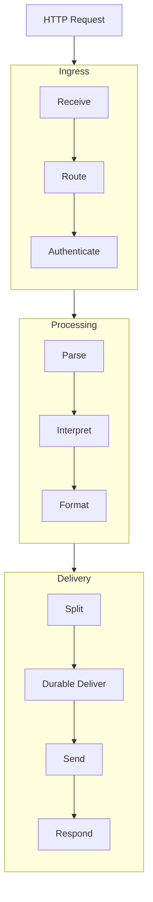
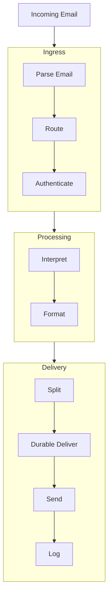
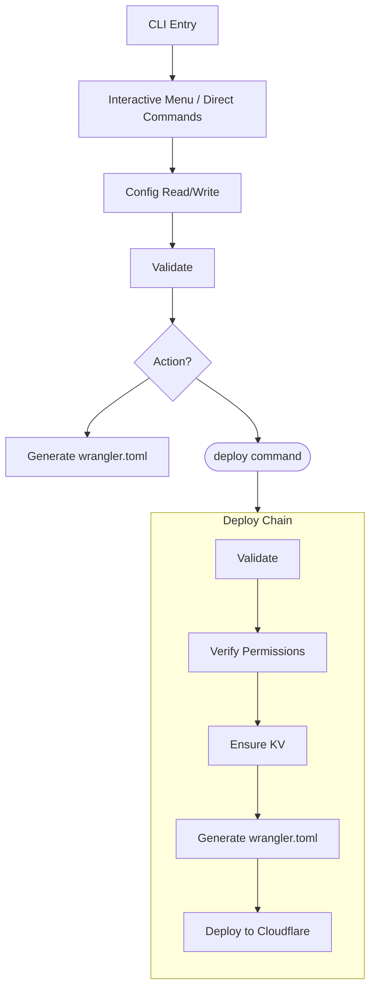

import { Terminology } from '@cbnventures/docusaurus-preset-nova/blocks';

Understand the two entry points, processing <Terminology title="The steps every webhook or email goes through, in order" to="/docs/reference/terminology#how-it-works">pipelines</Terminology>, error strategy, and source structure of Reverse Proxy for ntfy.

## Overview

Reverse Proxy for ntfy has two entry points running on different runtimes:

- **Cloudflare <Terminology title="The proxy itself, running on your Cloudflare account" to="/docs/reference/terminology#how-it-works">Worker</Terminology>** — Handles incoming HTTP webhooks and email messages. Runs on Cloudflare's edge network.
- **Node.js CLI** — Manages the configuration file. Runs locally on your machine.

The <Terminology title="The proxy itself, running on your Cloudflare account" to="/docs/reference/terminology#how-it-works">worker</Terminology> and CLI are cleanly separated. The CLI writes `config.json`, and deploy bundles a copy into the <Terminology title="The proxy itself, running on your Cloudflare account" to="/docs/reference/terminology#how-it-works">worker</Terminology>, which checks it once when it starts instead of on every request and email.

Shipping the config inside the <Terminology title="The proxy itself, running on your Cloudflare account" to="/docs/reference/terminology#how-it-works">worker</Terminology> avoids environment variables, which Cloudflare caps at 5 KB each, so the number of <Terminology title="One alert source: its address, interpreter, and topic" to="/docs/reference/terminology#how-it-works">contexts</Terminology> has no small fixed limit. A test config with 5,000 <Terminology title="One alert source: its address, interpreter, and topic" to="/docs/reference/terminology#how-it-works">contexts</Terminology> built a <Terminology title="The proxy itself, running on your Cloudflare account" to="/docs/reference/terminology#how-it-works">worker</Terminology> of about 430 KiB gzipped that spent about 25 ms of CPU starting up on a laptop.

## HTTP Pipeline

The <Terminology title="The proxy itself, running on your Cloudflare account" to="/docs/reference/terminology#how-it-works">worker</Terminology> processes HTTP requests through a linear 10-stage <Terminology title="The steps every webhook or email goes through, in order" to="/docs/reference/terminology#how-it-works">pipeline</Terminology>. Each stage transforms data and passes it to the next.

Failures before durable storage stop the <Terminology title="The steps every webhook or email goes through, in order" to="/docs/reference/terminology#how-it-works">pipeline</Terminology> and return an error response. A transient delivery failure after storage returns HTTP 202 and leaves the notification queued for alarm-driven retries. Permanent failures are discarded, while transient rows expire only after 24 hours and at least three failed attempts.



### Stage Details

**Receive** — Extracts method, hostname, headers, and raw body from the incoming request. Redirects HTTP to HTTPS automatically (except on localhost).

- Rejects methods other than GET, POST, and PUT.
- GET requests skip the <Terminology title="The steps every webhook or email goes through, in order" to="/docs/reference/terminology#how-it-works">pipeline</Terminology> and return the <Terminology title="Open a context's URL in a browser to see it's up" to="/docs/reference/terminology#configuration">landing page</Terminology>.

**Route** — Matches the request's subdomain against configured HTTP <Terminology title="One alert source: its address, interpreter, and topic" to="/docs/reference/terminology#how-it-works">contexts</Terminology>. Resolves the <Terminology title="One alert source: its address, interpreter, and topic" to="/docs/reference/terminology#how-it-works">context</Terminology>'s <Terminology title="One of your ntfy instances: a name, URL, and token" to="/docs/reference/terminology#ntfy-servers-and-messages">server</Terminology> list and <Terminology title="The ntfy server send-once tries first" to="/docs/reference/terminology#ntfy-servers-and-messages">primary server</Terminology>.

- Returns 404 if no matching <Terminology title="One alert source: its address, interpreter, and topic" to="/docs/reference/terminology#how-it-works">context</Terminology> is found.
- On `localhost`, the `X-NRP-Context` header names the <Terminology title="One alert source: its address, interpreter, and topic" to="/docs/reference/terminology#how-it-works">context</Terminology> instead (see [Local Development](/docs/reference/local-development/#local-testing)).

**Authenticate** — Validates the `Authorization` header against the <Terminology title="One alert source: its address, interpreter, and topic" to="/docs/reference/terminology#how-it-works">context</Terminology>'s optional token or <Terminology title="A short-lived, one-use pass a sender gets from /session" to="/docs/reference/terminology#configuration">session token</Terminology>. If the <Terminology title="One alert source: its address, interpreter, and topic" to="/docs/reference/terminology#how-it-works">context</Terminology> has neither configured, all requests are allowed.

- With `session` set, a `POST` or `PUT` to `/session` gets a new <Terminology title="A short-lived, one-use pass a sender gets from /session" to="/docs/reference/terminology#configuration">session token</Terminology> and ends the request here.

- Returns 403 on failure.
- Optionally forwards error details directly to the `error_topic` if configured. This best-effort send bypasses the durable lane so its failure cannot block normal notifications.

**Parse** — Classifies the request body as JSON, text, or binary. Detects binary content via content-type headers or null byte scanning.

- Attempts JSON parsing if the content-type is `application/json` or the body starts with `{` or `[`.
- Returns 400 (`Unknown content type`) for an empty body.

**Interpret** — Invokes the <Terminology title="One alert source: its address, interpreter, and topic" to="/docs/reference/terminology#how-it-works">context</Terminology>'s configured <Terminology title="Turns one app's raw alert into a clean ntfy message" to="/docs/reference/terminology#how-it-works">interpreter</Terminology> to transform the raw payload into a standardized <Terminology title="The title, body, and tags an interpreter hands back" to="/docs/reference/terminology#how-it-works">notification object</Terminology> (title, body, priority, tags, icon, actions, etc.). HTML is automatically stripped from the notification body.

- Returns 422 if interpretation fails.
- Returns a null result if the <Terminology title="Turns one app's raw alert into a clean ntfy message" to="/docs/reference/terminology#how-it-works">interpreter</Terminology> intentionally ignores the payload, which produces an HTTP 200 with status `"ignored"`.

**Format** — Builds the final message body and <Terminology title="The X-Title, X-Priority, and friends sent to ntfy" to="/docs/reference/terminology#ntfy-servers-and-messages">ntfy headers</Terminology> (`X-Title`, `X-Priority`, `X-Tags`, `X-Markdown`, `X-Icon`, `X-Actions`, etc.). Appends visitor information (IP, location, ISP) if `show_visitor_info` is enabled.

**Split** — Splits messages exceeding 4000 UTF-8 bytes into <Terminology title="Long messages arrive as (1/3), (2/3), (3/3)" to="/docs/reference/terminology#ntfy-servers-and-messages">numbered parts</Terminology>. Each part gets a title suffix like "(1/3)", "(2/3)", "(3/3)".

- Messages under the limit pass through as a single part.

**Deliver** — Saves a normal formatted notification and optional attachment in the SQLite-backed delivery outbox assigned to the context ID, then asks that lane to drain oldest-first.

- A transiently failed head stays saved and blocks only that context's later notifications until it succeeds or expires after 24 hours with at least three failed attempts.
- One Durable Object alarm retries the head with exponential backoff. A new notification for the same context can also trigger a drain without adding another alarm.
- Network status `0`, HTTP 408, HTTP 429, and HTTP 5xx responses are transient. Most HTTP 4xx responses, invalid saved JSON, and missing or renamed configured servers are permanent.
- A permanent or expired head emits a discard log, optionally sends a one-shot diagnostic to the context's `error_topic`, and is removed before the same drain continues with later notifications.
- Other context lanes continue independently. See [Durable Delivery](/docs/features/durable-delivery/) for the full behavior.

**Send** — Delivers notification parts to ntfy <Terminology title="One of your ntfy instances: a name, URL, and token" to="/docs/reference/terminology#ntfy-servers-and-messages">servers</Terminology> according to the delivery mode.

- In `send-once` mode, tries the <Terminology title="The ntfy server send-once tries first" to="/docs/reference/terminology#ntfy-servers-and-messages">primary server</Terminology> first, then fallbacks in order.
- In `send-all` mode, sends to all <Terminology title="One of your ntfy instances: a name, URL, and token" to="/docs/reference/terminology#ntfy-servers-and-messages">servers</Terminology> in parallel.
- Handles <Terminology title="A file sent along with the notification" to="/docs/reference/terminology#ntfy-servers-and-messages">attachments</Terminology> as a separate PUT request per <Terminology title="One of your ntfy instances: a name, URL, and token" to="/docs/reference/terminology#ntfy-servers-and-messages">server</Terminology>.
- Checkpoints successful message parts and attachments so retries skip confirmed work.

**Respond** — Builds the JSON response. Completed delivery returns HTTP 200. A notification that is safely saved but still waiting returns `"queued"` with HTTP 202.

- Includes detailed <Terminology title="Shows what happened inside the proxy, secrets masked" to="/docs/reference/terminology#configuration">debug output</Terminology> if `show_response_output` is enabled.

## Email Pipeline

The email <Terminology title="The steps every webhook or email goes through, in order" to="/docs/reference/terminology#how-it-works">pipeline</Terminology> processes messages from <Terminology title="Lets an email address trigger the proxy like a webhook" to="/docs/reference/terminology#cloudflare-setup">Cloudflare Email Routing</Terminology> through 9 stages.



**Parse Email** — Parses the raw RFC 5322 email message. Extracts from, to, subject, and text body.

- Handles multipart/alternative MIME messages, preferring text/plain over HTML.

**Route** — Matches the recipient's local part (before the `@`) to a <Terminology title="One alert source: its address, interpreter, and topic" to="/docs/reference/terminology#how-it-works">context</Terminology> ID.

**Authenticate** — Validates the sender address against the <Terminology title="One alert source: its address, interpreter, and topic" to="/docs/reference/terminology#how-it-works">context</Terminology>'s `allowed_from` field. Supports exact match and wildcard patterns (`*@domain.com`).

The remaining stages (Interpret, Format, Split, Deliver, Send) work identically to the HTTP <Terminology title="The steps every webhook or email goes through, in order" to="/docs/reference/terminology#how-it-works">pipeline</Terminology>.

**Log** — Outputs a debug JSON log with <Terminology title="One alert source: its address, interpreter, and topic" to="/docs/reference/terminology#how-it-works">context</Terminology> name, <Terminology title="Turns one app's raw alert into a clean ntfy message" to="/docs/reference/terminology#how-it-works">interpreter</Terminology>, <Terminology title="One of your ntfy instances: a name, URL, and token" to="/docs/reference/terminology#ntfy-servers-and-messages">server</Terminology> results, body size, and part count to Cloudflare's real-time logs.

- Email processing is silent — there is no HTTP response to return.
- Email routing failures (e.g., no matching <Terminology title="One alert source: its address, interpreter, and topic" to="/docs/reference/terminology#how-it-works">context</Terminology> ID for the recipient address) are silent — no error notification is sent to `error_topic`.

## CLI Architecture



The CLI reads and writes `config.json` through a config I/O layer. All config mutations go through schema validation.

- The generate command produces a `wrangler.toml` file from the config and writes it next to your `config.json`, plus the <Terminology title="The proxy itself, running on your Cloudflare account" to="/docs/reference/terminology#how-it-works">worker</Terminology> entry and a copy of the config in `.wrangler/ntfy-reverse-proxy/` beside it.
- The deploy command chains validation, permission verification, KV provisioning, <Terminology title="Generated from config.json for Wrangler to deploy" to="/docs/reference/terminology#cloudflare-setup">wrangler.toml</Terminology> generation, and deployment into a single step.

## Error Strategy

| Layer              | Strategy                                                                                                                                                                                                                                                                                                                                                                                                                                                                                                                                                                                                                                       |
|--------------------|------------------------------------------------------------------------------------------------------------------------------------------------------------------------------------------------------------------------------------------------------------------------------------------------------------------------------------------------------------------------------------------------------------------------------------------------------------------------------------------------------------------------------------------------------------------------------------------------------------------------------------------------|
| Worker entry point | Try/catch around entire <Terminology title="The steps every webhook or email goes through, in order" to="/docs/reference/terminology#how-it-works">pipeline</Terminology>. Returns JSON with HTTP status. Includes <Terminology title="Shows what happened inside the proxy, secrets masked" to="/docs/reference/terminology#configuration">debug details</Terminology> if `show_response_output` is on.                                                                                                                                                                                                                                       |
| Pipeline stages    | Each stage returns a typed result or throws. The entry point identifies which stage failed.                                                                                                                                                                                                                                                                                                                                                                                                                                                                                                                                                    |
| Interpreters       | Manual payload extraction. The `ntfy-json` <Terminology title="Turns one app's raw alert into a clean ntfy message" to="/docs/reference/terminology#how-it-works">interpreter</Terminology> and the `transmission-vpn`, `pfsense-actions`, `discord-stonker-bot`, `outpost`, and `mailmask` <Terminology title="Turns one app's raw alert into a clean ntfy message" to="/docs/reference/terminology#how-it-works">interpreters</Terminology> use non-strict schema checks; all others use lenient field detection. Malformed JSON and schema failures throw. The entry point can forward the failure directly to `error_topic` if configured. |
| Delivery outbox    | Persists before sending. Retries transient failures through one exponential-backoff Durable Object alarm, preserves them for at least 24 hours, and requires at least three failed attempts before expiry. Permanent failures are discarded immediately. Both paths continue the lane after a discard.                                                                                                                                                                                                                                                                                                                                         |
| Error topics       | Sends `error-debug.json` directly as a one-shot diagnostic. Authentication and interpretation failures use this path, as does an outbox discard when `error_topic` is configured. A failed diagnostic is not retried and never enters or blocks the durable delivery lane.                                                                                                                                                                                                                                                                                                                                                                     |
| Send/fallback      | Never throws. Collects per-<Terminology title="One of your ntfy instances: a name, URL, and token" to="/docs/reference/terminology#ntfy-servers-and-messages">server</Terminology> results. Primary failure triggers fallback. Returns success/failure per <Terminology title="One of your ntfy instances: a name, URL, and token" to="/docs/reference/terminology#ntfy-servers-and-messages">server</Terminology>.                                                                                                                                                                                                                            |
| CLI                | Try/catch at command level. Chalk-formatted errors. Non-zero exit code on failure.                                                                                                                                                                                                                                                                                                                                                                                                                                                                                                                                                             |
| Config validation  | Schema validation on load. Checks orphaned <Terminology title="One of your ntfy instances: a name, URL, and token" to="/docs/reference/terminology#ntfy-servers-and-messages">server</Terminology> refs, duplicate <Terminology title="One alert source: its address, interpreter, and topic" to="/docs/reference/terminology#how-it-works">context</Terminology> IDs, missing fields, invalid token format.                                                                                                                                                                                                                                   |

## Source Structure

```text
src/
  worker/
    index.ts                 — Worker entry point (fetch + email handlers)
    handlers.ts              — HTTP and email pipeline orchestration
    durable-objects/
      delivery-outbox.ts     — Per-context SQLite FIFO lane
    pipeline/
      receive.ts             — Extract request metadata
      route.ts               — Match subdomain/email to context
      authenticate.ts        — Validate tokens and sender addresses
      session.ts             — Issue and verify session tokens
      parse.ts               — Detect body type (text, JSON, binary)
      interpret.ts           — Dispatcher to interpreter modules
      accumulate.ts          — KV state management for Statuspage
      format.ts              — Build message body and ntfy headers
      split.ts               — Smart split for large messages
      email.ts               — RFC 5322 email parser
      deliver.ts             — Persist and trigger the context lane
      drain-fifo.ts          — Oldest-first drain behavior
      send.ts                — Deliver to servers with fallback
      respond.ts             — Build HTTP response
    interpreters/
      plain-text.ts          — Pass-through text or binary attachment
      ntfy-json.ts           — ntfy JSON mapping
      synology.ts            — Synology DSM webhooks
      statuspage.ts          — Statuspage.io webhooks
      seerr.ts               — Seerr media requests
      pfsense.ts             — pfSense email notifications
      unifi.ts               — UniFi email notifications
      app-payload.ts         — Shared reader for app alert payloads
      transmission-vpn.ts    — Transmission VPN alerts
      pfsense-actions.ts     — pfSense Actions alerts
      discord-stonker-bot.ts — Discord Stonker Bot alerts
      outpost.ts             — Outpost alerts
      mailmask.ts            — Mailmask refusal alerts
    landing/
      page.ts                — Landing page HTML
  cli/
    index.ts                 — CLI entry point
    commands/
      server.ts              — Server CRUD
      context.ts             — Context CRUD
      settings.ts            — Settings management
      config-io.ts           — Config file read/write
      generate.ts            — wrangler.toml generation
      validate.ts            — Config validation
      deploy.ts              — Cloudflare deployment
    menu/
      interactive.ts         — Interactive TUI
  lib/
    item.ts                  — App name constant
    package-runtime.ts       — Packaged CLI paths and version
    regex.ts                 — Shared regex patterns
    schema.ts                — Zod schemas
    utility.ts               — Helper functions (HTML stripping)
  tests/                     — Unit and integration tests (mirrors src/)
  types/                     — TypeScript type definitions (mirrors src/)
```
